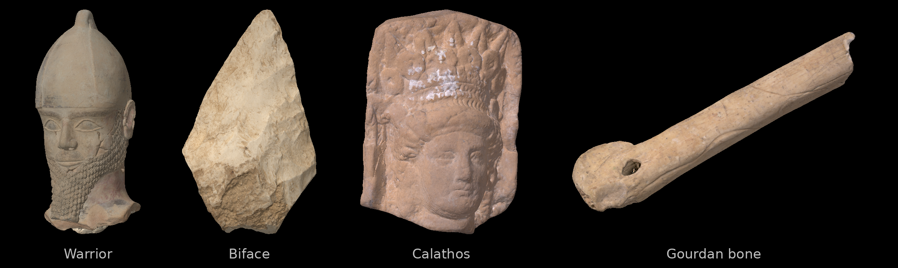

<!-- TODO at the Zenodo publication: check the dataset DOI (version DOI 10.5281/zenodo.23500437, concept DOI known
only then); proceedings DOI of the paper when available (badges, BibTeX, CITATION.cff). -->

# Integrating Multi-view Multi-light Surface Reconstruction into Cultural Heritage Workflows

[](#citation)
[](https://arxiv.org/abs/2609.15833)
[](https://doi.org/10.5281/zenodo.23500437)
[](https://creativecommons.org/licenses/by/4.0/)
[](LICENSE)
[](https://github.com/alicevision/Meshroom/tree/develop)

[Baptiste Brument](https://bbrument.github.io/) · [Robin Bruneau](https://robinbruneau.github.io/) ·
[Benjamin Coupry](https://scholar.google.com/citations?user=H5LhL7AAAAAJ) · [Vincent Demoulin](https://www.linkedin.com/in/vincent-demoulin-6b9562a9/) ·
[Jean Mélou](https://scholar.google.com/citations?user=t9PRZ3AAAAAJ) ·
[Antoine Laurent](https://cv.hal.science/antoine-laurent-archeologie) ·
[Fabien Castan](https://www.linkedin.com/in/fabien-castan-99729453/) ·
[Jean-Denis Durou](https://cv.hal.science/jean-denis-durou) ·
[Lilian Calvet](https://www.linkedin.com/in/lilian-calvet-42b1a689/)

**Companion repository of the VISART dataset** ([paper](https://arxiv.org/abs/2609.15833)): Meshroom templates, installation guide and tested versions to
reconstruct the four archaeological objects of the paper from their raw multi-view and multi-light images. The images
are on [Zenodo](https://doi.org/10.5281/zenodo.23500437); this repository holds everything that changes with the
software: versions, installation, settings, known issues.

## The dataset

Four objects, each imaged as a multi-view set (MV, one illumination) and a multi-light set (PS, several viewpoints each
under several illuminations), as Nikon RAW files (NEF, 45.7 MP).

| Object | MV images | PS viewpoints × lights | PS images | Method of the paper | Template |
| :-- | --: | :-- | --: | :-- | :-- |
| Warrior | 121 | 13 × 8-10 (hand-held flash) | 114 | LED-getter | [`warrior_visart-eccv26.mgt`](templates/warrior/warrior_visart-eccv26.mgt) |
| Biface | 162 | 12 × 13 (12-LED rig) | 156 | LED-getter | [`biface_visart-eccv26.mgt`](templates/biface/biface_visart-eccv26.mgt) |
| Calathos | 48 | 6 × 36, 1 × 106, 1 × 29 (RTI dome, flash) | 351 | LED-getter | [`calathos_visart-eccv26.mgt`](templates/calathos/calathos_visart-eccv26.mgt) |
| Gourdan bone | (in PS) | 23 × 36 (RTI dome) | 828 | Uni-MS-PS | [`gourdan_bone_visart-eccv26.mgt`](templates/gourdan_bone/gourdan_bone_visart-eccv26.mgt) |

Acquisition, file naming and object descriptions: see the [dataset page](https://doi.org/10.5281/zenodo.23500437).
The dataset provides no masks: the templates compute them with SAM 3.

## Quick start

1. Download `[object]_MV.zip` and `[object]_PS.zip` from [Zenodo](https://doi.org/10.5281/zenodo.23500437) and extract
   them in the same folder.
2. Install Meshroom develop, AliceVision and the plugins: [docs/INSTALL.md](docs/INSTALL.md).
3. Copy `templates/[object]/` of this repository into the extracted `[object]/` folder.
4. Open the template in Meshroom (*Open Template*), drop the object folder on the image gallery and compute, or, from
   the command line:

```bash
scripts/run_template.sh templates/biface/biface_visart-eccv26.mgt /data/visart/biface /data/runs/biface
```

## Templates

```text
templates/
├── warrior/
│   ├── warrior_visart-eccv26.mgt            method of the paper (LED-getter)
│   └── templates/
│       └── warrior_lino_unips.mgt           alternative (LINO-UniPS)
├── biface/
│   ├── biface_visart-eccv26.mgt             method of the paper (LED-getter)
│   └── templates/
│       └── biface_lino_unips.mgt            alternative (LINO-UniPS)
├── calathos/
│   ├── calathos_visart-eccv26.mgt           method of the paper (LED-getter)
│   └── templates/
│       └── calathos_lino_unips.mgt          alternative (LINO-UniPS)
└── gourdan_bone/
    ├── gourdan_bone_visart-eccv26.mgt       method of the paper (Uni-MS-PS)
    └── templates/
        ├── gourdan_bone_lino_unips.mgt      alternative (LINO-UniPS)
        └── gourdan_bone_led_getter.mgt      alternative (LED-getter)
```

`[object]_visart-eccv26.mgt` reproduces the method of the paper; `templates/` holds alternatives (LINO-UniPS for all
objects, LED-getter for the Gourdan bone). Each pipeline goes from the RAW images to a mesh textured with the albedo:
SAM 3 masks, structure-from-motion, photometric stereo per viewpoint, RNb-NeuS2 integration of the normals and albedo,
texturing. Details, and how to regenerate the templates with `scripts/build_templates.py`:
[docs/TEMPLATES.md](docs/TEMPLATES.md).

The templates are set for a 16 GB GPU. To reproduce the settings of the paper (NVIDIA A100):

| Setting | Templates | Paper |
| :-- | :-- | :-- |
| `downscale` of the photometric stereo nodes | 2 | 1 |
| `nbImages` of `UniMSPS` and `LINOUniPS` | 10 | -1 (all) |
| `meshResolution` of `RNbNeuS2` | 512 | 1024 |

## Installation

The templates need Meshroom **develop**. In short ([full guide](docs/INSTALL.md)):

- AliceVision develop, built from source or nightly build, plus a few missing resources;
- Meshroom develop, with five open fixes of the plugin manager merged locally
  ([#3256](https://github.com/alicevision/Meshroom/pull/3256)-[#3260](https://github.com/alicevision/Meshroom/pull/3260));
- the plugins, with `meshroom_plugins install`: mrLedGetter, mrUniMSPS, mrLINOUniPS, mrRNbNeuS2 from the official
  registry, mrSegmentation through [`registry/visartSegmentation.json`](registry/visartSegmentation.json);
- the SAM 3 checkpoint, from Hugging Face (gated model).

## Tested versions and known issues

Last end-to-end test: **2026-11-12**, Meshroom develop `de4b5661` with the five fixes, AliceVision `6f9f58ec` or nightly,
mrLedGetter v1.0.2, mrLINOUniPS v2.0.4, mrRNbNeuS2 v1.1.2, mrSegmentation `976a63b` ([details](docs/TESTED_VERSIONS.md)).

Main limitations ([all issues and workarounds](docs/KNOWN_ISSUES.md)):

- LINO-UniPS needs a GPU of compute capability 8.0 or newer (Ampere).
- mrSegmentation is not in the official registry yet, and misses a dependency (OpenImageIO).
- The LED-getter templates convert the SfMData to `.sfm` (`ConvertSfMFormat`) before the LED-getter nodes, to work
  with the AliceVision nightly build (numpy 1 bindings).

## Related projects

| Repository | Role |
| :-- | :-- |
| [Meshroom](https://github.com/alicevision/Meshroom), [AliceVision](https://github.com/alicevision/AliceVision) | Node-based 3D reconstruction framework, photogrammetry |
| [mrLedGetter](https://github.com/meshroomHub/mrLedGetter) | Self-calibrated near-light photometric stereo (LED-getter) |
| [mrUniMSPS](https://github.com/meshroomHub/mrUniMSPS) | Universal photometric stereo (Uni-MS-PS) |
| [mrLINOUniPS](https://github.com/meshroomHub/mrLINOUniPS) | Universal photometric stereo (LINO-UniPS), normals and albedo |
| [mrSDMUniPS](https://github.com/meshroomHub/mrSDMUniPS) | Universal photometric stereo (SDM-UniPS), no template provided |
| [mrRNbNeuS2](https://github.com/meshroomHub/mrRNbNeuS2), [RNb-NeuS2](https://github.com/RobinBruneau/RNb-NeuS2) | Multi-view integration of normals and reflectance |
| [mrSegmentation](https://github.com/meshroomHub/mrSegmentation) | Object masks (SAM 3) |

## License

Code and templates: [MIT](LICENSE). Dataset: [CC BY 4.0](https://creativecommons.org/licenses/by/4.0/), see
[Zenodo](https://doi.org/10.5281/zenodo.23500437).

## Acknowledgements

Baptiste Brument was funded by the OPEN-DOPAMIn project (CNRS Innovation). This work was granted access to the Juliet
computing platform, supported by a French government grant managed by the Agence Nationale de la Recherche under the
"Investissements d'avenir" program (reference "ANR-21-ESRE-0051"). It has been supported by the University of Zurich
and University Hospital Balgrist. We thank the Musée Saint-Raymond, Toulouse, for access to the warrior head and the
woman with a calathos.

## Citation

If you use the dataset or these templates, please cite:

```bibtex
@inproceedings{brument2026mvps,
  author    = {Brument, Baptiste and Bruneau, Robin and Coupry, Benjamin and Demoulin, Vincent and M{\'e}lou, Jean and Laurent, Antoine and Castan, Fabien and Durou, Jean-Denis and Calvet, Lilian},
  title     = {Integrating Multi-view Multi-light Surface Reconstruction into Cultural Heritage Workflows},
  booktitle = {European Conference on Computer Vision (ECCV) Workshops, VISART},
  year      = {2026},
  eprint    = {2609.15833},
  archivePrefix = {arXiv},
  primaryClass  = {cs.CV},
  url       = {https://arxiv.org/abs/2609.15833}
}
```

## Updates

- **2026-11-12**: first version. History of the changes and of the tests: [docs/CHANGELOG.md](docs/CHANGELOG.md).
