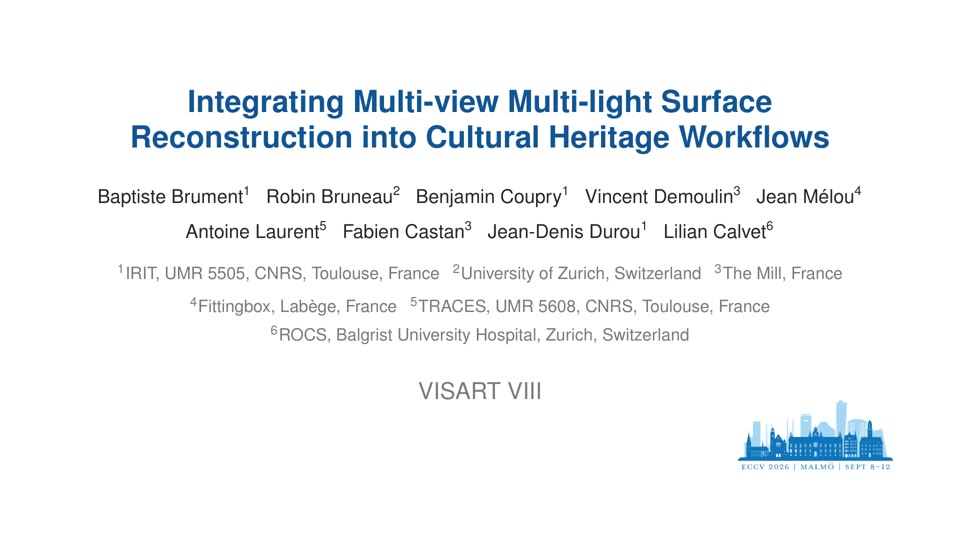

# Integrating Multi-view Multi-light Surface Reconstruction into Cultural Heritage Workflows

[](#citation)
[](https://arxiv.org/abs/2609.15833)
[](https://doi.org/10.5281/zenodo.23500436)
[](https://creativecommons.org/licenses/by/4.0/)
[](LICENSE)
[](https://github.com/alicevision/Meshroom/tree/develop)

[Baptiste Brument](https://bbrument.github.io/) · [Robin Bruneau](https://robinbruneau.github.io/) ·
[Benjamin Coupry](https://scholar.google.com/citations?user=H5LhL7AAAAAJ) · [Vincent Demoulin](https://www.linkedin.com/in/vincent-demoulin-6b9562a9/) ·
[Jean Mélou](https://scholar.google.com/citations?user=t9PRZ3AAAAAJ) ·
[Antoine Laurent](https://cv.hal.science/antoine-laurent-archeologie) ·
[Fabien Castan](https://www.linkedin.com/in/fabien-castan-99729453/) ·
[Jean-Denis Durou](https://cv.hal.science/jean-denis-durou) ·
[Lilian Calvet](https://www.linkedin.com/in/lilian-calvet-42b1a689/)

**Companion repository of the VISART dataset**: Meshroom templates that reconstruct its four archaeological objects
from the raw images, as in the [paper](https://arxiv.org/abs/2609.15833). Images on
[Zenodo](https://doi.org/10.5281/zenodo.23500436).

## Videos

<table>
  <tr>
    <td width="33%"><a href="https://youtu.be/S7PQEvSg3I0"></a></td>
    <td width="33%"><a href="https://youtu.be/THf_pcn83hU"></a></td>
    <td width="33%"><a href="https://youtu.be/jfdkJYho4dM"></a></td>
  </tr>
  <tr>
    <td align="center">Supplementary video of the paper</td>
    <td align="center">Warrior head: photogrammetry vs. MVPS</td>
    <td align="center">Gourdan bone: photogrammetry vs. MVPS</td>
  </tr>
</table>

## Data

Each object is imaged as a multi-view set (MV: one illumination, for photogrammetry) and a multi-light set (PS: several
viewpoints, each under several illuminations, for photometric stereo), as Nikon RAW files (NEF, 45.7 MP). No masks:
the templates compute them with SAM 3.

| Object | | MV images | PS viewpoints × lights | PS images | Method of the paper |
| :-- | :-- | --: | :-- | --: | :-- |
| Warrior | head of a Cypriot warrior, terracotta, 6th century BC | 121 | 13 × 8-10 (hand-held flash) | 114 | LED-getter |
| Biface | flint biface | 162 | 12 × 13 (12-LED rig) | 156 | LED-getter |
| Calathos | woman with a calathos, ceramic, 4th century BC | 48 | 6 × 36, 1 × 106, 1 × 29 (RTI dome, flash) | 351 | LED-getter |
| Gourdan bone | engraved bone from the Gourdan cave | (in PS) | 23 × 36 (RTI dome) | 828 | Uni-MS-PS |

Archives `[object]_MV.zip` and `[object]_PS.zip` (Gourdan bone: PS only). File names, cameras and lighting: [dataset
page](https://doi.org/10.5281/zenodo.23500436).

## Quick start

1. Install Meshroom develop and the plugins: [docs/INSTALL.md](docs/INSTALL.md).
2. Extract the archives of an object from Zenodo, and copy `templates/[object]/` into the extracted folder:

   ```text
   [object]/
   ├── MV/*.NEF                         multi-view set, one illumination
   ├── PS/PS_xx/*.NEF                   multi-light set: one folder per viewpoint, one image per light
   ├── [object]_visart-eccv26.mgt       method of the paper
   └── templates/                       alternatives
   ```

3. Compute:
   - **UI:** *File > Open Template*, drop the object folder on the image gallery, save, compute.
   - **Command line:**

     ```bash
     scripts/run_template.sh templates/biface/biface_visart-eccv26.mgt /data/visart/biface /data/runs/biface
     # nightly bundle: MESHROOM_BUNDLE=/path/to/Meshroom-<date>-<commit>-linux scripts/run_template.sh …
     ```

2-8 hours per object at full resolution ([tested versions](docs/TESTED_VERSIONS.md)).

## Templates

| Template | Photometric stereo | Output |
| :-- | :-- | :-- |
| `warrior_visart-eccv26.mgt` | LED-getter, lights per viewpoint (hand-held flash) | textured mesh |
| `biface_visart-eccv26.mgt` | LED-getter, one light set for the 12-LED rig | textured mesh |
| `calathos_visart-eccv26.mgt` | LED-getter, one light set for the dome | textured mesh |
| `gourdan_bone_visart-eccv26.mgt` | Uni-MS-PS | mesh (no albedo) |
| `[object]/templates/[object]_lino_unips.mgt` | LINO-UniPS (alternative) | textured mesh |
| `gourdan_bone/templates/gourdan_bone_led_getter.mgt` | LED-getter (alternative) | textured mesh |

Each template computes the object masks (SAM 3), the camera poses (structure-from-motion on MV and PS), per-view
normals by photometric stereo, a mesh by RNb-NeuS2 and, when the PS method gives an albedo, its texture.

Set for a 16 GB GPU; the paper used an A100:

| Setting | Templates | Paper |
| :-- | :-- | :-- |
| `downscale` (`LedGetterLights`, `LedGetterPS`, `UniMSPS`, `LINOUniPS`) | 2 | 1 |
| `nbImages` (`UniMSPS`, `LINOUniPS`) | 10 | -1 (all) |
| `meshResolution` (`RNbNeuS2`) | 512 | 1024 |

Generated by [`scripts/build_templates.py`](scripts/build_templates.py).

## Related projects

| Repository | Role |
| :-- | :-- |
| [Meshroom](https://github.com/alicevision/Meshroom), [AliceVision](https://github.com/alicevision/AliceVision) | Node-based 3D reconstruction framework, photogrammetry |
| [mrLedGetter](https://github.com/meshroomHub/mrLedGetter) | Self-calibrated near-light photometric stereo (LED-getter) |
| [mrUniMSPS](https://github.com/meshroomHub/mrUniMSPS) | Universal photometric stereo (Uni-MS-PS) |
| [mrLINOUniPS](https://github.com/meshroomHub/mrLINOUniPS) | Universal photometric stereo (LINO-UniPS), normals and albedo |
| [mrRNbNeuS2](https://github.com/meshroomHub/mrRNbNeuS2), [RNb-NeuS2](https://github.com/RobinBruneau/RNb-NeuS2) | Multi-view integration of normals and reflectance |
| [mrSegmentation](https://github.com/meshroomHub/mrSegmentation) | Object masks (SAM 3) |

## License

Code and templates: [MIT](LICENSE). Dataset: [CC BY 4.0](https://creativecommons.org/licenses/by/4.0/), see
[Zenodo](https://doi.org/10.5281/zenodo.23500436).

## Acknowledgements

Baptiste Brument was funded by the OPEN-DOPAMIn project (CNRS Innovation). This work was granted access to the Juliet
computing platform, supported by a French government grant managed by the Agence Nationale de la Recherche under the
"Investissements d'avenir" program (reference "ANR-21-ESRE-0051"). It has been supported by the University of Zurich
and University Hospital Balgrist. We thank the Musée Saint-Raymond, Toulouse, for access to the warrior head and the
woman with a calathos.

## Citation

If you use the dataset or these templates, please cite:

```bibtex
@inproceedings{brument2026mvps,
  author    = {Brument, Baptiste and Bruneau, Robin and Coupry, Benjamin and Demoulin, Vincent and M{\'e}lou, Jean and Laurent, Antoine and Castan, Fabien and Durou, Jean-Denis and Calvet, Lilian},
  title     = {Integrating Multi-view Multi-light Surface Reconstruction into Cultural Heritage Workflows},
  booktitle = {European Conference on Computer Vision (ECCV) Workshops, VISART},
  year      = {2026},
  eprint    = {2609.15833},
  archivePrefix = {arXiv},
  primaryClass  = {cs.CV},
  url       = {https://arxiv.org/abs/2609.15833}
}
```
